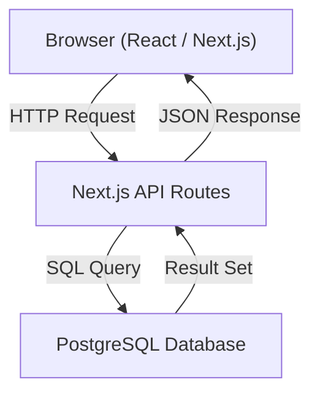
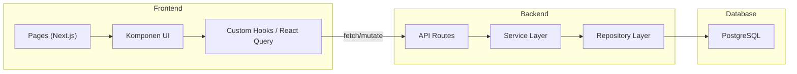

# Dokumen Desain: COOL Living Sacrifice — Komsel Firman Sharing

## Overview

Website **COOL Living Sacrifice** adalah aplikasi web yang memungkinkan anggota komsel (COOL) untuk mencatat, berbagi, dan mengelola ringkasan sharing firman Tuhan. Platform ini berfokus pada kemudahan penggunaan tanpa autentikasi berbasis akun penuh — pengguna diidentifikasi berdasarkan nama yang mereka isi saat menambahkan sharing, dan kepemilikan data dikelola secara sederhana melalui creator token.

### Tujuan Utama

- Menyediakan ruang digital untuk mencatat dan melihat kembali sharing firman dari setiap pertemuan komsel.
- Memungkinkan anggota untuk mencari dan memfilter sharing berdasarkan kata kunci atau nama pembagi.
- Mendukung akses dari berbagai perangkat (ponsel, tablet, komputer).

### Pendekatan Teknis

Aplikasi ini dibangun sebagai **Single-Page Application (SPA) berbasis web** dengan:
- **Frontend**: React + TypeScript dengan Tailwind CSS untuk tampilan responsif.
- **Backend**: Next.js dengan API Routes (full-stack, satu aplikasi).
- **Database**: PostgreSQL untuk penyimpanan data relasional.
- **State Management**: React Query (TanStack Query) untuk fetching dan caching data dari API.

> **Keputusan Desain**: Dipilih Next.js dengan API Routes karena memungkinkan deployment yang lebih sederhana (satu aplikasi) dan cocok untuk skala kecil komunitas komsel. PostgreSQL dipilih untuk kemudahan kueri teks dan kemampuan full-text search di masa depan.

---

## Architecture

### Gambaran Umum Arsitektur



### Lapisan Aplikasi



### Alur Data Utama

1. **Menampilkan Daftar**: Browser memuat halaman utama → API `/api/sharing-firman` → DB `SELECT` → JSON → Render daftar.
2. **Menambah Sharing**: Pengguna mengisi formulir → API `POST /api/sharing-firman` → Validasi → DB `INSERT` → Redirect ke detail.
3. **Mengedit Sharing**: Pengguna mengubah data → API `PUT /api/sharing-firman/:id` → Validasi kepemilikan → DB `UPDATE`.
4. **Menghapus Sharing**: Pengguna konfirmasi → API `DELETE /api/sharing-firman/:id` → Validasi kepemilikan → DB `DELETE`.
5. **Mencari**: Pengguna mengetik kata kunci → API `GET /api/sharing-firman?q=kata` → DB `ILIKE` → Render hasil.

---

## Components and Interfaces

### Halaman (Pages)

| Halaman | Route | Deskripsi |
|---|---|---|
| Halaman Utama / Daftar | `/` | Menampilkan daftar sharing firman + pencarian + filter |
| Halaman Detail | `/sharing/:id` | Menampilkan isi lengkap satu sharing firman |
| Halaman Tambah | `/sharing/baru` | Formulir untuk menambah sharing firman baru |
| Halaman Edit | `/sharing/:id/edit` | Formulir untuk mengedit sharing firman yang sudah ada |

### Komponen UI Utama

```
components/
├── SharingCard.tsx          # Kartu ringkasan di halaman daftar (judul, pembagi, tanggal, cuplikan)
├── SharingList.tsx          # Daftar kartu sharing firman
├── SharingForm.tsx          # Formulir tambah/edit (digunakan ulang)
├── SearchBar.tsx            # Input pencarian dengan debounce
├── FilterDropdown.tsx       # Dropdown filter berdasarkan nama pembagi
├── DeleteConfirmDialog.tsx  # Dialog konfirmasi hapus
├── CharacterCounter.tsx     # Penghitung karakter tersisa real-time
├── EmptyState.tsx           # Tampilan ketika tidak ada data
└── ErrorMessage.tsx         # Tampilan pesan kesalahan
```

### API Endpoints (REST)

| Method | Endpoint | Deskripsi |
|---|---|---|
| `GET` | `/api/sharing-firman` | Mengambil daftar (mendukung `?q=`, `?pembagi=`, `?page=`, `?limit=`) |
| `GET` | `/api/sharing-firman/:id` | Mengambil detail satu sharing firman |
| `POST` | `/api/sharing-firman` | Membuat sharing firman baru |
| `PUT` | `/api/sharing-firman/:id` | Memperbarui sharing firman |
| `DELETE` | `/api/sharing-firman/:id` | Menghapus sharing firman |

#### Request/Response Contracts

**`POST /api/sharing-firman`** — Request Body:
```json
{
  "nama_pembagi": "string (wajib, maks. 255 karakter)",
  "judul": "string (wajib, maks. 200 karakter)",
  "tanggal_sharing": "string ISO 8601 (wajib, tidak boleh di masa depan)",
  "isi_ringkasan": "string (wajib, maks. 5000 karakter)",
  "ayat_referensi": "string (opsional, maks. 100 karakter)"
}
```

**`GET /api/sharing-firman`** — Response:
```json
{
  "data": [
    {
      "id": "uuid",
      "judul": "string",
      "nama_pembagi": "string",
      "tanggal_sharing": "date",
      "cuplikan": "string (maks. 150 karakter dari isi_ringkasan)",
      "ayat_referensi": "string | null",
      "dibuat_pada": "datetime",
      "diperbarui_pada": "datetime"
    }
  ],
  "total": "number",
  "page": "number",
  "limit": "number"
}
```

> **Catatan Keamanan**: Server membuat `creator_token` dan mengembalikannya **satu kali pada POST sukses**, terpisah dari model data publik: `{ data: SharingFirman, creator_token: string }`. Respons memakai `Cache-Control: no-store`. GET list, GET detail, dan PUT tidak pernah mengembalikan token. Client menyimpan token di localStorage lalu mengirimkannya dalam body PUT/DELETE untuk verifikasi kepemilikan.

### Mekanisme Kepemilikan (Ownership)

Karena tidak ada sistem login penuh, kepemilikan dikelola dengan **creator token**:
- Saat pengguna membuat sharing, server membuat UUID unik sebagai `creator_token`, memberikannya sekali dalam respons POST, dan client menyimpannya di `localStorage` browser.
- Token ini dikirim di header atau body setiap request edit/hapus.
- Backend memverifikasi bahwa `creator_token` cocok dengan yang tersimpan di database.
- Jika tidak cocok, sistem mengembalikan HTTP 403 Forbidden.

#### Batasan Perangkat (Browser-Bound Ownership)

**Edit dan hapus hanya bisa dilakukan dari browser/perangkat yang sama tempat sharing pertama kali dibuat.** Ini adalah konsekuensi langsung dari penyimpanan token di `localStorage`:

- `creator_token` disimpan di `localStorage` browser yang digunakan saat membuat sharing.
- Jika pengguna membuka sharing dari browser atau perangkat lain, `creator_token` tidak tersedia di `localStorage` perangkat tersebut.
- Jika pengguna menghapus `localStorage` (mis. clear browser data, private/incognito mode, reinstall), token hilang secara permanen.
- **Tidak ada mekanisme pemulihan** — token yang hilang tidak dapat dikembalikan.
- UI tidak menampilkan tombol edit/hapus sama sekali jika `creator_token` untuk sharing tersebut tidak ditemukan di `localStorage` (bukan sekadar menyembunyikan berdasarkan ownership, tapi berdasarkan keberadaan token di browser saat itu).

> **Keputusan Desain**: Pembatasan ini disengaja dan sesuai dengan karakter komunitas kecil yang saling percaya. Kompleksitas pemulihan akun tidak sepadan untuk konteks penggunaan ini. Jika pengguna tidak bisa mengedit dari perangkat saat ini, ia dapat meminta anggota yang membuatnya dari perangkat asli untuk melakukan perubahan.

---

## Data Models

### Skema Database

#### Tabel `sharing_firman`

```sql
CREATE TABLE sharing_firman (
    id              UUID PRIMARY KEY DEFAULT gen_random_uuid(),
    judul           VARCHAR(200)   NOT NULL,
    nama_pembagi    VARCHAR(255)   NOT NULL,
    tanggal_sharing DATE           NOT NULL CHECK (tanggal_sharing <= (CURRENT_TIMESTAMP AT TIME ZONE 'Asia/Jakarta')::date),
    isi_ringkasan   TEXT           NOT NULL CHECK (char_length(isi_ringkasan) <= 5000),
    ayat_referensi  VARCHAR(100),
    creator_token   UUID           NOT NULL,
    dibuat_pada     TIMESTAMPTZ    NOT NULL DEFAULT NOW(),
    diperbarui_pada TIMESTAMPTZ    NOT NULL DEFAULT NOW()
);

-- Indeks untuk mendukung pencarian dan pengurutan
CREATE INDEX idx_sharing_firman_tanggal ON sharing_firman (tanggal_sharing DESC, dibuat_pada DESC);
CREATE INDEX idx_sharing_firman_nama_pembagi ON sharing_firman (nama_pembagi);
```

### TypeScript Interfaces

```typescript
// Model data inti — hanya field yang aman dikembalikan ke client
interface SharingFirman {
  id: string;                  // UUID
  judul: string;               // maks. 200 karakter
  nama_pembagi: string;        // maks. 255 karakter
  tanggal_sharing: string;     // format YYYY-MM-DD (tanggal kalender lokal, zona waktu Jakarta)
  isi_ringkasan: string;       // maks. 5000 karakter
  ayat_referensi?: string;     // opsional, maks. 100 karakter
  dibuat_pada: string;         // ISO 8601 datetime
  diperbarui_pada: string;     // ISO 8601 datetime
}

// Interface internal — TIDAK pernah dikirim ke client
// Hanya digunakan di lapisan repository dan service (database ↔ backend)
interface SharingFirmanWithToken extends SharingFirman {
  creator_token: string;       // UUID untuk verifikasi kepemilikan — hanya ada di database
}

// DTO internal repository untuk pembuatan (creator_token dibuat di server, bukan input POST)
type CreateSharingFirmanDTO = Omit<SharingFirman, 'id' | 'dibuat_pada' | 'diperbarui_pada'> & {
  creator_token: string;       // dibuat server, disimpan ke DB, diberikan ke client hanya sekali
};

// DTO untuk pembaruan (creator_token diterima dari client untuk verifikasi, tidak dikembalikan)
type UpdateSharingFirmanDTO = Partial<
  Pick<SharingFirman, 'judul' | 'nama_pembagi' | 'tanggal_sharing' | 'isi_ringkasan' | 'ayat_referensi'>
> & { creator_token: string };

// Response daftar dengan cuplikan — tidak mengandung creator_token
interface SharingFirmanListItem {
  id: string;
  judul: string;
  nama_pembagi: string;
  tanggal_sharing: string;
  cuplikan: string;            // 150 karakter pertama dari isi_ringkasan
  ayat_referensi?: string;
  dibuat_pada: string;
  diperbarui_pada: string;
}

// Parameter query untuk daftar/pencarian
interface SharingFirmanQueryParams {
  q?: string;                  // Kata kunci pencarian (judul + isi_ringkasan)
  pembagi?: string;            // Filter berdasarkan nama_pembagi
  page?: number;               // Halaman (default: 1)
  limit?: number;              // Jumlah per halaman (default: 9; maksimum: 100)
}
```

### Validasi Bisnis

| Field | Aturan Validasi |
|---|---|
| `judul` | Wajib diisi, 1–200 karakter |
| `nama_pembagi` | Wajib diisi, 1–255 karakter |
| `tanggal_sharing` | Wajib diisi, format tanggal valid, tidak boleh melebihi hari ini (zona waktu Jakarta, WIB UTC+7) |
| `isi_ringkasan` | Wajib diisi, 1–5000 karakter |
| `ayat_referensi` | Opsional, maks. 100 karakter jika diisi |
| `creator_token` | UUID valid, wajib untuk operasi edit/hapus |

---

## Correctness Properties

*Sebuah properti adalah karakteristik atau perilaku yang harus berlaku benar di seluruh eksekusi sistem yang valid — pada dasarnya, sebuah pernyataan formal tentang apa yang seharusnya dilakukan sistem. Properti berfungsi sebagai jembatan antara spesifikasi yang dapat dibaca manusia dan jaminan kebenaran yang dapat diverifikasi oleh mesin.*

### Property 1: Cuplikan tidak melebihi 150 karakter

*Untuk setiap* Sharing_Firman dengan `isi_ringkasan` panjang apa pun, cuplikan yang dikembalikan dalam daftar SHALL tidak pernah melebihi 150 karakter, terlepas dari panjang asli isi ringkasan.

**Validates: Requirements 1.1**

### Property 2: Urutan daftar selalu menurun berdasarkan tanggal

*Untuk setiap* daftar Sharing_Firman yang dikembalikan tanpa filter aktif, urutan SHALL selalu menurun berdasarkan `tanggal_sharing` — artinya setiap elemen ke-i memiliki tanggal yang lebih baru atau sama dengan elemen ke-(i+1). Jika dua entri memiliki `tanggal_sharing` yang sama, entri dengan `dibuat_pada` yang lebih baru SHALL muncul lebih dahulu.

**Validates: Requirements 1.1, 5.4**

### Property 3: Data yang disimpan dapat diambil kembali secara utuh

*Untuk setiap* Sharing_Firman dengan data valid yang berhasil dibuat (POST sukses), mengambil detail sharing tersebut (GET /:id) SHALL mengembalikan semua field yang dikirimkan secara identik (round-trip penyimpanan dan pengambilan data).

**Validates: Requirements 2.2, 2.3**

### Property 4: Tanggal sharing tidak boleh di masa depan

*Untuk setiap* tanggal yang nilainya lebih besar dari tanggal hari ini, sistem SHALL menolak operasi CREATE maupun UPDATE dengan pesan error yang menjelaskan bahwa tanggal tidak boleh melebihi hari ini.

**Validates: Requirements 2.5**

### Property 5: Kolom wajib yang kosong atau hanya whitespace selalu ditolak

*Untuk setiap* kombinasi input formulir di mana salah satu kolom wajib (`judul`, `nama_pembagi`, `tanggal_sharing`, `isi_ringkasan`) kosong atau hanya berisi karakter whitespace, sistem SHALL menolak penyimpanan dan mengembalikan pesan error yang menyebut kolom mana saja yang bermasalah.

**Validates: Requirements 2.4, 3.3**

### Property 6: Hasil pencarian selalu relevan terhadap kata kunci

*Untuk setiap* kata kunci pencarian (setelah di-trim dari spasi awal/akhir) dan koleksi Sharing_Firman yang tersimpan, semua Sharing_Firman yang dikembalikan SHALL mengandung kata kunci tersebut sebagai substring di `judul` atau `isi_ringkasan` secara case-insensitive (cocok bila kata kunci muncul di mana saja dalam field tersebut), dan tidak ada Sharing_Firman yang relevan yang terlewat dari hasil. Pencarian diimplementasikan menggunakan parameterized query dengan `ILIKE`, bukan string interpolation.

**Validates: Requirements 5.1**

### Property 7: Filter nama pembagi menghasilkan hasil yang eksklusif

*Untuk setiap* nama pembagi yang dipilih sebagai filter, semua Sharing_Firman yang dikembalikan SHALL memiliki `nama_pembagi` yang sama persis dengan filter yang dipilih, dan tidak ada Sharing_Firman dari pembagi lain yang ikut muncul.

**Validates: Requirements 5.2**

### Property 8: Reset pencarian mengembalikan seluruh daftar terurut

*Untuk setiap* kondisi pencarian atau filter yang aktif, menghapus semua filter dan kata kunci SHALL menghasilkan daftar yang identik dengan daftar awal tanpa filter, diurutkan menurun berdasarkan `tanggal_sharing` dengan tiebreaker `dibuat_pada` menurun.

**Validates: Requirements 5.4**

### Property 9: Operasi edit dan hapus ditolak untuk bukan pemilik

*Untuk setiap* Sharing_Firman dan setiap `creator_token` yang berbeda dari token pemilik asli, upaya edit (PUT) maupun hapus (DELETE) SHALL selalu ditolak dengan HTTP 403, terlepas dari konten permintaan lainnya.

**Validates: Requirements 3.5, 4.5**

### Property 10: Penghapusan bersifat permanen

*Untuk setiap* Sharing_Firman yang berhasil dihapus (DELETE sukses), mengambil data tersebut kembali (GET /:id) SHALL selalu mengembalikan HTTP 404 — data tidak dapat ditemukan kembali setelah penghapusan berhasil.

**Validates: Requirements 4.2**

---

## Error Handling

### Kategori Kesalahan

| Kode HTTP | Kondisi | Pesan ke Pengguna |
|---|---|---|
| `400 Bad Request` | Kolom wajib kosong atau format tidak valid | Pesan spesifik per kolom (mis. "Judul wajib diisi") |
| `400 Bad Request` | Tanggal sharing di masa depan | "Tanggal sharing tidak boleh melebihi tanggal hari ini" |
| `403 Forbidden` | `creator_token` tidak cocok | "Aksi tidak diizinkan" |
| `404 Not Found` | Data tidak ditemukan | "Sharing firman tidak ditemukan" |
| `429 Too Many Requests` | Melebihi batas 10 pembuatan per IP per jam | "Terlalu banyak permintaan. Silakan coba lagi dalam beberapa saat." |
| `500 Internal Server Error` | Kesalahan database atau server | "Data tidak dapat dimuat. Silakan coba kembali." |

### Strategi Penanganan Kesalahan

**Frontend**:
- React Query menangkap error dari API dan menyimpannya di state `error`.
- Komponen `ErrorMessage` ditampilkan ketika state `error` tidak null.
- Formulir menampilkan pesan validasi inline di bawah setiap kolom yang bermasalah.
- Penghitung karakter berwarna merah ketika mendekati atau mencapai batas 5000 karakter.

**Backend**:
- Middleware validasi (`zod`) memvalidasi semua input sebelum menyentuh database.
- Error database ditangkap di lapisan repository dan dilempar sebagai error aplikasi terstandarisasi.
- Semua response error mengikuti format JSON yang konsisten:
  ```json
  {
    "error": true,
    "message": "Pesan kesalahan yang dapat dibaca manusia",
    "fields": { "nama_field": "pesan_error_per_kolom" }
  }
  ```

### Penanganan Kasus Tepi (Edge Cases)

- **Batas keras `isi_ringkasan`**: Frontend mencegah pengetikan setelah 5000 karakter menggunakan atribut `maxLength` dan event handler, bukan hanya validasi saat submit.
- **Cuplikan 150 karakter**: Dilakukan di backend sebelum mengirim response daftar, memotong berdasarkan batas karakter.
- **Pencarian dengan karakter khusus**: Implementasi menggunakan **parameterized query** (bukan string interpolation) sebagai perlindungan utama dari SQL injection. Karakter wildcard seperti `%` dan `_` di-escape sebelum dimasukkan ke pattern `ILIKE`, sehingga diperlakukan sebagai karakter biasa. Spasi di awal/akhir kata kunci di-trim sebelum digunakan.
- **Tanggal zona waktu**: `tanggal_sharing` merepresentasikan tanggal kalender lokal di zona waktu Jakarta (WIB, UTC+7). Validasi "tidak boleh melebihi hari ini" dilakukan dengan membandingkan terhadap tanggal hari ini di WIB. Server menggunakan `new Date().toLocaleDateString('en-CA', { timeZone: 'Asia/Jakarta' })` atau ekuivalen untuk mendapatkan tanggal referensi yang benar. Ini penting agar pengguna di Indonesia tidak mengalami penolakan pada jam malam karena perbedaan UTC.
- **Creator token tidak ditemukan di localStorage**: Jika `creator_token` untuk sebuah sharing tidak ada di `localStorage` browser pengguna saat ini (mis. berpindah perangkat, menghapus data browser), UI **tidak menampilkan tombol edit/hapus sama sekali**. Ini bukan sekadar sembunyikan berdasarkan kepemilikan — jika tokennya tidak ada di browser, opsi tersebut tidak relevan dan tidak ditampilkan.
- **Daftar kosong**: Komponen `EmptyState` menampilkan teks "Belum ada sharing firman yang tercatat".
- **Gagal muat data**: Komponen `ErrorMessage` menampilkan pesan dengan saran untuk mencoba kembali.

### Keamanan Operasional

#### Rate Limiting

Untuk mencegah penyalahgunaan (spam data), diberlakukan batas frekuensi pembuatan sharing:

- **Batas**: Maksimal **10 sharing baru per IP per jam**.
- **Implementasi**: Pemeriksaan di route `POST /api/sharing-firman` dengan counter atomik PostgreSQL sehingga kuota konsisten lintas instance. Identitas IP hanya dibaca dari header yang ditimpa reverse proxy tepercaya (`TRUSTED_IP_HEADER`); tanpa konfigurasi tersebut digunakan kuota bersama.
- Response ketika batas terlampaui: HTTP `429 Too Many Requests` dengan pesan "Terlalu banyak permintaan. Silakan coba lagi dalam beberapa saat."

#### Validasi Server-Side

- Validasi input di **server (backend) selalu dilakukan** terlepas dari validasi di frontend. Validasi frontend hanya untuk UX — ia tidak boleh dijadikan satu-satunya lapisan keamanan.
- Semua kolom teks di-**trim whitespace** di server sebelum disimpan ke database.
- Panjang maksimum semua field divalidasi di **server** (melalui Zod schema), tidak hanya bergantung pada database constraint.

---

## Testing Strategy

### Pendekatan Pengujian Ganda

Fitur ini menggunakan kombinasi:
- **Unit tests**: Memverifikasi contoh spesifik, kasus tepi, dan kondisi error.
- **Property-based tests**: Memverifikasi properti universal di berbagai input acak.

### Unit Tests (Jest + React Testing Library)

- **Komponen UI**: Render dan interaksi dasar (`SharingCard`, `SharingForm`, `DeleteConfirmDialog`).
- **Validasi**: Contoh konkret untuk setiap aturan validasi (judul kosong, tanggal masa depan, dst.).
- **API**: Uji parser JSON, pemeriksaan origin, dan response error dengan unit test; endpoint lengkap diuji melalui HTTP pada database PostgreSQL tertanam terpisah.
- **Utility functions**: `truncateToSnippet`, tanggal WIB, validasi, dan pemberian token oleh service create.

### Property-Based Tests (fast-check)

Library yang digunakan: **[fast-check](https://github.com/dubzzz/fast-check)** — library property-based testing untuk JavaScript/TypeScript.

Setiap property-based test dikonfigurasi untuk berjalan minimal **100 iterasi** per properti.

Setiap test diberi tag komentar dengan format:
```
// Feature: komsel-firman-sharing, Property {N}: {teks_properti}
```

**Pemetaan Properti ke Test:**

| Properti | Deskripsi Test |
|---|---|
| Property 1 | Generate `isi_ringkasan` acak berbagai panjang, pastikan cuplikan selalu ≤ 150 karakter |
| Property 2 | Generate daftar sharing dengan tanggal acak, pastikan urutan selalu menurun |
| Property 3 | Generate data valid acak, POST lalu GET, pastikan data identik (round-trip) |
| Property 4 | Generate tanggal acak di masa depan, pastikan selalu ditolak dengan error |
| Property 5 | Generate kombinasi kolom wajib kosong/whitespace, pastikan selalu ditolak |
| Property 6 | Generate kata kunci dan data acak, pastikan hasil pencarian selalu relevan |
| Property 7 | Generate data dengan berbagai nama pembagi, filter satu nama, pastikan eksklusif |
| Property 8 | Terapkan filter acak lalu reset, pastikan hasil identik dengan daftar tanpa filter |
| Property 9 | Generate token acak berbeda dari pemilik, pastikan PUT/DELETE selalu ditolak 403 |
| Property 10 | Generate sharing acak, hapus, GET kembali, pastikan selalu 404 |

### Integration Tests (Playwright)

- Uji end-to-end alur CRUD lengkap dengan database test terpisah.
- Uji responsivitas layout pada viewport 320px, 768px, 1024px, dan 1920px.
- Uji tampilan pesan kesalahan saat database tidak tersedia.
- Uji ukuran area sentuh elemen interaktif di viewport mobile (≥ 44x44 piksel).
